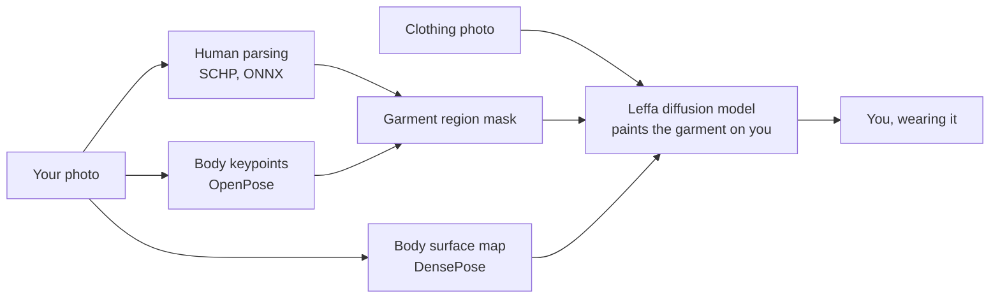

# CLOAK 👗👔

**Screenshot it from the vendor's page. Try it on yourself. Then decide.**

CLOAK is an open-source virtual fitting room. Upload a photo of yourself and a photo of a top, trousers,
skirt or dress, and an open-weight AI model shows you wearing it. Try different combinations and compare
them on your moodboard, each new look next to the photo you started from, before you pay.

Built for **OPEN//BUILD 2026** (OSCA Ile-Ife Hacktoberfest Challenge).

- **Live demo:** _add your gradio.live link or demo video here_
- **Run it yourself:** [Open the Colab notebook](notebooks/CLOAK_Colab.ipynb) (free T4 GPU)

> _Add a screenshot: `docs/screenshot.png`_

---

## The problem

Most young Nigerians we know buy clothes from vendors on Instagram, WhatsApp and TikTok. You see a
picture of the item on a mannequin or on someone else, pay upfront, and wait. There is no fitting room,
and returns are rare or come with stress and extra delivery costs. "What I ordered vs what I got" is a
running joke because it happens so often.

The biggest unknown is simple: **how will this look on me, and with what I already own?**
For students and young workers on a tight budget, a wrong purchase is money that doesn't come back.

**Who it's for:** people buying clothes online from social-media vendors, who want to check how a
style, colour or print looks on their own body, and which combination works, before paying.

## What CLOAK does

1. **Your photo:** upload or snap a photo of yourself.
2. **The outfit:** add a top and/or a bottom, or a dress/gown. Screenshots from a vendor's page work
   once cropped to the item.
3. **See yourself:** CLOAK dresses you in the full outfit.
4. **Compare:** every look is pinned to your moodboard as a before-and-after pair, with the garments used, so you can compare combinations at a glance.

## How it works



For a full outfit, CLOAK runs this twice: **bottom first, then top**, feeding the first result into
the second, so the top's hem is drawn last and sits naturally over the waistband. A dress or gown
replaces both in a single pass.

## The AI model and why we chose it

**Main model: [Leffa](https://huggingface.co/franciszzj/Leffa)** (*Learning Flow Fields in Attention for
Controllable Person Image Generation*, CVPR 2025). Open weights, **MIT licence**.

Leffa is a diffusion model built on Stable Diffusion 1.5 inpainting. It uses two networks: a reference
network reads the clothing photo, and a generative network repaints the masked body region. During
training, Leffa adds a loss that teaches attention to "look at" the matching spot on the garment, which
reduces distortion of fine details such as text, logos, stripes and prints.

Why it suits CLOAK:

- **Detail preservation matters for our users.** Ankara, adire and lace are defined by their patterns.
  A model that smears prints would be useless for the clothes our users actually buy.
- **It covers full outfits.** Two released checkpoints: one trained on VITON-HD (tops, sharpest results)
  and one trained on DressCode (tops, bottoms and dresses). CLOAK routes each garment to the right one.
- **Clear licence.** Leffa's code and weights are MIT. A popular alternative, IDM-VTON, releases its
  code and checkpoints under CC BY-NC-SA 4.0 (non-commercial, share-alike). (Leffa's supporting models and training data
  still carry their own terms; see [ACKNOWLEDGEMENTS.md](ACKNOWLEDGEMENTS.md).)
- **It runs on free hardware.** With the memory changes below, it fits on a free Colab T4 GPU.

Supporting open models (they prepare the inputs Leffa needs): SCHP human parsing, OpenPose body
keypoints and DensePose body surface estimation.

## Run it

### Option A: Google Colab (recommended, free)

1. Open [`notebooks/CLOAK_Colab.ipynb`](notebooks/CLOAK_Colab.ipynb) in Colab.
2. `Runtime > Change runtime type > T4 GPU`.
3. Run the cells. The last one prints a public `https://....gradio.live` link.

First run: about 5 to 10 minutes (downloads a few GB of weights). Each garment then takes roughly
15 to 40 seconds on a T4, depending on the quality setting.

### Option B: your own machine (NVIDIA GPU, 12 GB+ VRAM)

```bash
git clone https://github.com/YOUR_GITHUB_USERNAME/cloak.git
cd cloak
# install a CUDA build of PyTorch first: https://pytorch.org/get-started/locally/
bash setup.sh
python app.py
```

### Settings (environment variables)

| Variable | Default | What it does |
|---|---|---|
| `CLOAK_MODELS` | `both` | `both` loads VITON-HD (tops) and DressCode (bottoms, dresses). `dc` loads only DressCode and uses about half the memory. |
| `CLOAK_SHARE` | `1` | `1` creates a public gradio.live link. `0` keeps it local. |
| `CLOAK_MOCK` | `0` | `1` runs the UI without a GPU or models, for interface work only. Output is watermarked "MOCK MODE". |
| `PORT` | `7860` | Port for the web app. |

### Tests

```bash
pip install pytest pillow numpy
pytest -q
```

The tests cover the image handling (phone-photo rotation, transparent PNGs, padding and cropping) and
the outfit logic in mock mode, so they run on any laptop without a GPU.

## Technical decisions

- **Gradio for the interface.** It gives a working web app with webcam upload, a public share link and
  a queue in a few hundred lines of Python, which kept our 5-day effort on the AI pipeline.
- **A custom design on top of Gradio.** A fashion-editorial look (serif display type, generous space)
  on a sleek dark interface (monospace labels, one lime accent), defined in `cloak/ui_style.py`. It
  adapts to Gradio's version and to phone screens. The moodboard is rendered as HTML so each look can
  show the original photo and the new look side by side.
- **Memory-safe loading for free Colab.** Each Leffa model has about 1.8 billion parameters. Built the
  default way (float32 first, then converted), one model needs over 7 GB of RAM before its weights load,
  enough to crash a free Colab session. CLOAK creates the model directly in float16 and reads weights
  with memory-mapping. Measured peak RAM for building one model dropped to about 4.3 GB, with an
  identical final model. See `TryOnEngine._build_leffa`.
- **Only the checkpoints we need.** `setup.sh` skips Leffa's pose-transfer and SDXL weights.
- **Garment routing.** Tops go to the VITON-HD model (best quality). Bottoms and dresses go to the
  DressCode model, the only one trained on them.
- **Layering order.** Bottom first, then top, so the top is generated over the trousers or skirt.
- **Real-world inputs.** Phone photos are rotated using their EXIF data, transparent PNG product images
  are placed on white (otherwise the transparent area turns black), and results are cropped back to
  your photo's original framing.
- **Pinned upstream code.** Leffa's source is fetched at a fixed commit so results are reproducible.

## Limitations (please read)

- **Style, not size.** CLOAK shows how a style, colour and print could look on you. It does not know
  your measurements or how the vendor's fabric actually fits, so it cannot promise an item will fit.
- **Training data bias.** The try-on models were trained on fashion catalogue photos from Western
  datasets. Very loose native styles (agbada, wide bubu), layered outfits and some skin tones may come
  out less accurately. We think fine-tuning on Nigerian fashion photos is the most important next step.
- **Input quality matters.** Best results come from a front-facing photo with arms by your sides and a
  clean product image. Busy screenshots, models in unusual poses and side views give weaker results.
- **Not covered:** caps, shoes, bags, glasses and hair.
- **Needs a GPU.** On CPU only, one garment can take many minutes.
- **Research licences.** Some supporting models and the training datasets are licensed for
  non-commercial research only, so CLOAK is a non-commercial prototype. See
  [ACKNOWLEDGEMENTS.md](ACKNOWLEDGEMENTS.md).
- **Privacy.** Photos are processed in memory for the session and not saved by CLOAK. A public
  gradio.live link is temporary, but anyone with it can use your running app, so share it carefully.

## Next steps

- Fine-tune on Nigerian fashion: Ankara, aso-ebi, native wear, and more diverse body types and skin tones.
- A vendor mode: vendors add their catalogue once, and buyers try items on straight from a product link.
- Size guidance from height and a few measurements.
- Accessories (caps, shoes) as open models for them improve.

## Project structure

```
cloak/
├── app.py                  # Gradio web app
├── cloak/engine.py         # try-on pipeline around Leffa
├── cloak/ui_style.py       # visual design: theme, CSS, moodboard
├── setup.sh                # installs libraries, fetches Leffa + checkpoints
├── requirements.txt
├── notebooks/CLOAK_Colab.ipynb
├── tests/                  # CPU-only tests (mock mode)
├── ACKNOWLEDGEMENTS.md     # models, data, licences, AI assistance
└── LICENSE                 # MIT (our code)
```

## Contributing

Issues and pull requests are welcome. Good first contributions: better photo-quality checks, more
garment categories, translations of the interface into Pidgin, Yoruba, Igbo and Hausa, and
evaluation on Nigerian fashion photos.

## Team

- _Favour (your surname)_, _University_
- _Teammate name_, _University_

## Licence

CLOAK's own code is released under the [MIT Licence](LICENSE). Models, datasets and libraries we use
keep their own licences, listed in [ACKNOWLEDGEMENTS.md](ACKNOWLEDGEMENTS.md).
